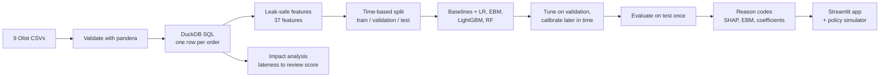

# OnTime - Explainable Late-Delivery Risk Engine

[](https://github.com/TheInfiniteLoop22/OnTime/actions/workflows/ci.yml)

**Predict, at the moment an e-commerce order is approved, whether it will miss the date promised to
the customer; explain every prediction in plain English; and turn the scores into a
capacity-aware plan for which orders operations should act on today.**

Built on the public [Olist Brazilian E-Commerce dataset](https://www.kaggle.com/datasets/olistbr/brazilian-ecommerce)
with classical ML only (logistic regression, EBM, LightGBM, random forest). No deep learning.

> This file is **generated** by `make report` from the project's result files, so every number
> below was produced by code in this repository (see `docs/templates/README.template.md`).

---

## Why it matters

Customers punish broken delivery promises. In this data, late orders are rated
**0.6 to 2.0 stars lower** than on-time orders after adjusting for price,
category, region, season and distance (an adjusted association, not a proven causal effect), and
**63%** of late orders end in a 1-2 star review versus **9%** of
on-time ones.

The twist: **70% of late orders were reviewed before the parcel arrived.**
Most of the damage happens while the customer is still waiting, so operations must act *before* the
promised date, which is exactly what a prediction at approval time enables.

## Headline results (test period, never used for tuning)

| | |
|---|---|
| Test period | 2018-05-01 to 2018-08-18 - 24,093 orders, 1,096 late (4.5%) |
| Primary model | **Logistic regression** (chosen by validation results *before* the test set was opened) |
| Ranking quality | PR-AUC **0.093** [0.085, 0.105] vs 0.045 for random ranking (2.0x better) |
| Capacity value | Acting on the riskiest 10% of each day's orders: precision **10.0%**, lift **2.2x** [1.85, 2.62] |
| Beats a hand-written rule? | Yes: the rule's PR-AUC is 0.048, essentially the base rate (0.045), while Logistic regression scores 0.093. |
| Glass-box vs black-box | EBM minus LightGBM = -0.004 PR-AUC, 95% CI [-0.009, +0.002] (no reliable difference) |
| Simulated benefit | at 10% daily capacity and an assumed 30% intervention success, about 74 late orders prevented (6.7% of all late) vs 33 for random selection; ceiling with perfect ranking 306 |

| Model | PR-AUC [95% CI] | ROC-AUC | Brier | Lift @10% [95% CI] |
|---|---|---|---|---|
| Guess the training rate | 0.045 [0.043, 0.048] | 0.500 | 0.0435 | 1.03 [0.89, 1.17] |
| Hand-written rule | 0.048 [0.045, 0.051] | 0.527 | 0.0436 | 0.94 [0.75, 1.15] |
| **Logistic regression** | 0.093 [0.085, 0.105] | 0.701 | 0.0435 | 2.20 [1.85, 2.62] |
| Random forest | 0.075 [0.069, 0.083] | 0.665 | 0.0462 | 1.63 [1.38, 1.89] |
| LightGBM | 0.078 [0.072, 0.086] | 0.683 | 0.0428 | 1.96 [1.66, 2.28] |
| EBM (glass-box) | 0.074 [0.068, 0.082] | 0.656 | 0.0430 | 1.64 [1.36, 1.96] |

PR-AUC is judged against the base rate (random ranking scores the late rate), and intervals are 95%
bootstrap intervals. Full detail: [`reports/results.md`](reports/results.md).

## How it works



### What makes it rigorous
- **No leakage.** Features use only what is known at approval time. Seller/route history counts a
  past order only if it was *delivered before* the current order's approval time (approval time
  alone is not enough). Five required leakage tests plus a property test against a brute-force loop.
- **Time-based splits only.** Train past -> validation -> test future; tuning and calibration use
  different, time-ordered slices of validation.
- **Test set touched once.** The code, the primary-model rule and the test run were committed in
  that order; the test split is locked behind an explicit `final_evaluation=True`.
- **No invented numbers.** Results, this README and the model card are generated from run outputs.
- **Honest reporting.** The negative results are in the write-up: see *Limitations*.

## What the model sees, and why

Every prediction comes with plain-English reasons. Example (true positive, order `d115642fba30...`,
model estimate 62%, actually late):

- On this seller-state to customer-state route, about 15% of earlier orders arrived late (adds risk)
- Delivery promise is 6.7 days, with 4.0 days for the seller to hand over (adds risk)
- Seller-to-customer distance is 595 km (adds risk)
- Order approved on a Friday in August at 8:00, 16 h after purchase (reduces risk)
- Paid by credit_card in up to 10 instalment(s) (reduces risk)

Reasons are exact decompositions of the model output (coefficients for logistic regression, shape
functions for the EBM, TreeSHAP for LightGBM), grouped so one idea is shown once, and phrased as
facts: the *(adds risk / reduces risk)* tag comes from the model, never from intuition.
Across the three explanation methods, global importance agrees most between LightGBM and the EBM (rank correlation 0.78); 26 of 32 numeric features have the same effect direction in at least two models. See [`notebooks/04_explainability.ipynb`](notebooks/04_explainability.ipynb).

## The app

```
make app        # streamlit run app/Home.py   (needs the pipeline artifacts)
```

| | |
|---|---|
|  |  |
|  |  |
|  |  |

## Run it yourself

```bash
git clone https://github.com/TheInfiniteLoop22/OnTime.git && cd OnTime
make setup                         # uv sync + pre-commit  (Python 3.11, uv required)

# 1) data: either use the Kaggle API (put kaggle.json in ~/.kaggle) ...
make data
# ... or download the zip manually and unzip the 9 CSVs into data/raw/

make all                           # data -> build -> features -> impact -> baselines
                                   #   -> train -> evaluate -> explain -> report
make app                           # open the Streamlit app
make test && make lint             # pytest (incl. a synthetic mini-Olist pipeline run) and ruff
```

The test suite includes an integration test that generates a tiny synthetic Olist-shaped dataset and
runs the real stages on it, so CI never needs the Kaggle download.

## Repository map

| Path | What is there |
|---|---|
| `src/ontime/data` | download, load, pandera schemas, DuckDB order table, data-quality report |
| `src/ontime/features` | geo, calendar, product and leak-safe history features, leakage demo |
| `src/ontime/models` | splits (test locked), baselines, training, tuning, calibration |
| `src/ontime/evaluation` | metrics with bootstrap CIs, slices, policy simulation, plots, results report |
| `src/ontime/explain` | EBM / SHAP / coefficient explanations, agreement, reason codes |
| `src/ontime/serving` | scoring + what-if service used by the app |
| `app/` | Streamlit app (`Home.py`, `views/`, `ontime_ui/`) |
| `notebooks/` | 01 EDA, 02 impact analysis, 03 modelling walkthrough, 04 explainability |
| `reports/` | generated results, model card, figures (the data and models are git-ignored) |
| `docs/` | specs, `PHASE_LOG.md` (what was done), `DECISIONS_LOG.md` (why), `LEARNING_LOG.md` (interview notes) |

## Limitations

- **Probabilities are relative scores.** The late rate moved from 5.6% (training) to
  4.5% (test) and month to month; calibrated percentages are overconfident for the
  riskiest orders. Use rank and risk bands. Monthly re-calibration did not fix this.
- **Ranking decays after training.** Primary-model ROC-AUC was 0.75 in 2018-05 and
  0.57 in 2018-08. Retraining and drift monitoring are required.
- **Modest, not magic.** Most late orders are not predictable from approval-time information (a
  carrier incident, a stock-out). The value is a better *queue*, not certainty.
- **Simulation, not measurement.** The policy benefit assumes an intervention success rate; the
  dataset has no experiment on interventions.
- **Associations, not causes.** Explanations describe the model; the review-score gap is adjusted
  but observational.
- **Calendar proxies.** `approve_month` and the holiday features mostly encode the part of the year
  the training data covered (flagged for removal in a v2).
- **One marketplace, 2016-2018.** Nothing here is validated on other platforms or periods.

## Future work

1. Retrain with expanding-window time-series CV so hyperparameters see several regimes; drop the
   calendar proxies; re-validate.
2. Drift monitoring page (PSI by feature, rolling PR-AUC) and scheduled retraining.
3. Quantile ETA model: could promises be shorter on safe routes and longer on risky ones?
4. FastAPI `/score` endpoint with reason codes (the scoring service already exists in `src/`).
5. A pilot with a randomized intervention to measure the success rate the simulator assumes.

## Data and licence

Olist Brazilian E-Commerce Public Dataset, CC BY-NC-SA 4.0: non-commercial use, attribution
required, share alike. The raw data is **not** committed; download it yourself. Code in this
repository is for portfolio/educational use.

## Documentation

[`docs/PROJECT_SPEC.md`](docs/PROJECT_SPEC.md) · [`docs/FEATURE_SPEC.md`](docs/FEATURE_SPEC.md) ·
[`docs/BUILD_PLAN.md`](docs/BUILD_PLAN.md) · [`docs/PHASE_LOG.md`](docs/PHASE_LOG.md) ·
[`docs/DECISIONS_LOG.md`](docs/DECISIONS_LOG.md) · [`docs/LEARNING_LOG.md`](docs/LEARNING_LOG.md) ·
[`reports/model_card.md`](reports/model_card.md) · [`reports/results.md`](reports/results.md) ·
[`reports/impact.json`](reports/impact.json)
