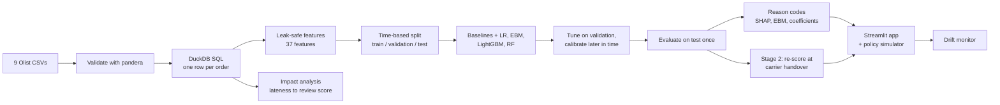
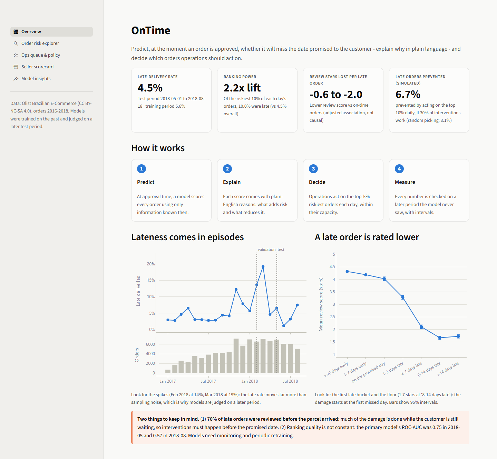
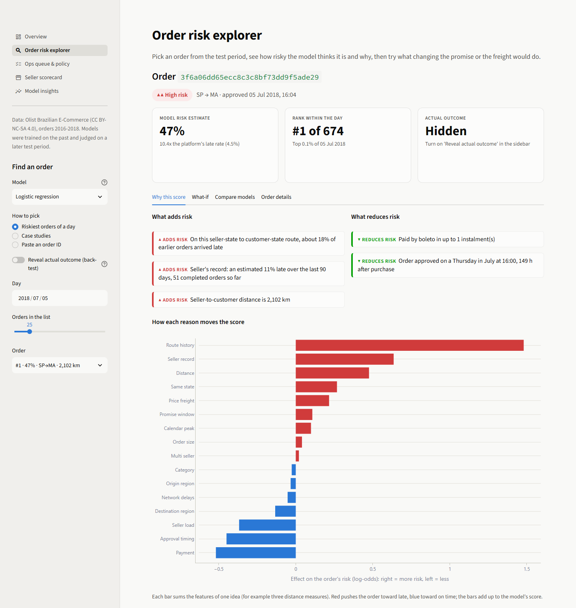
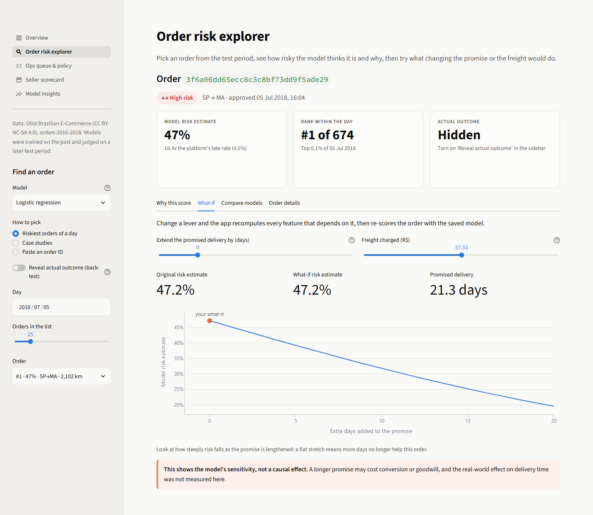
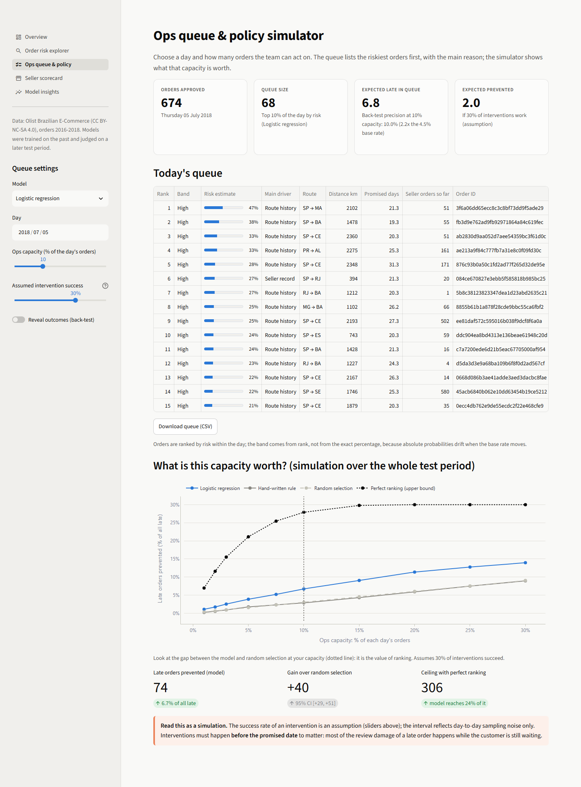
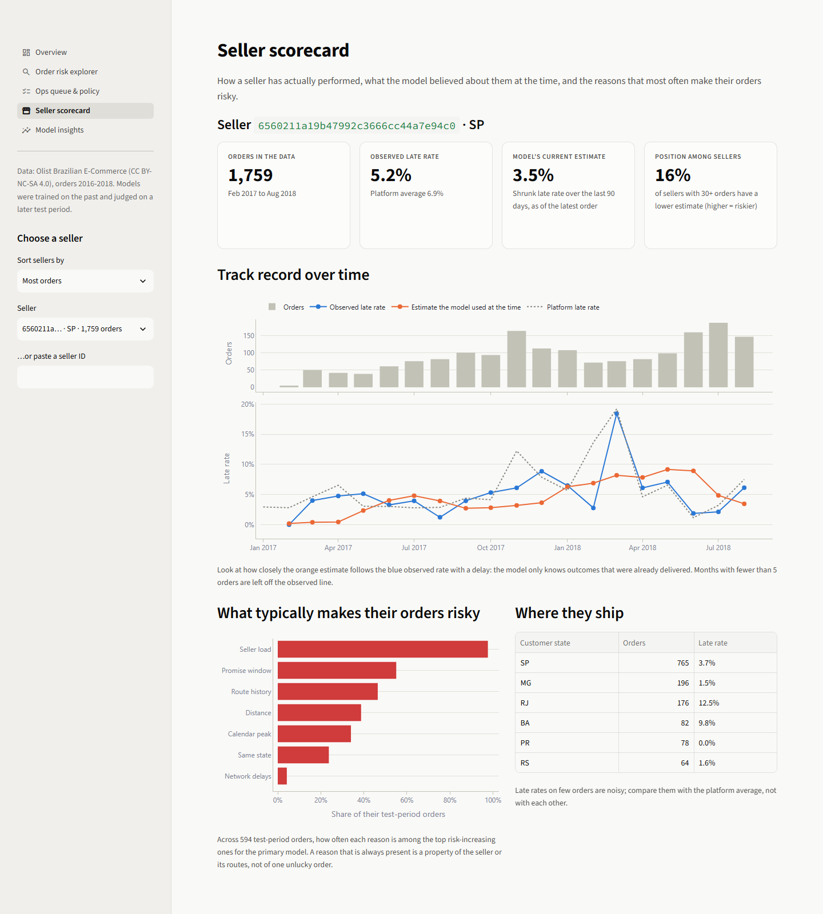
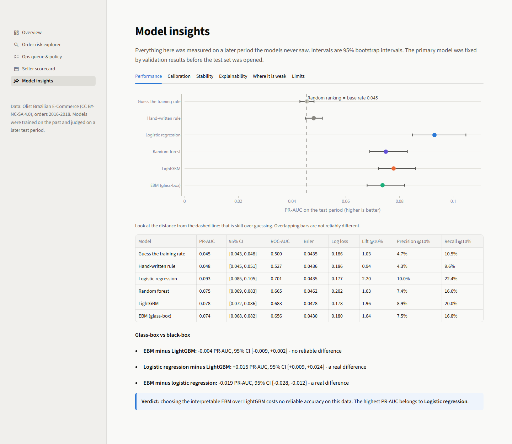
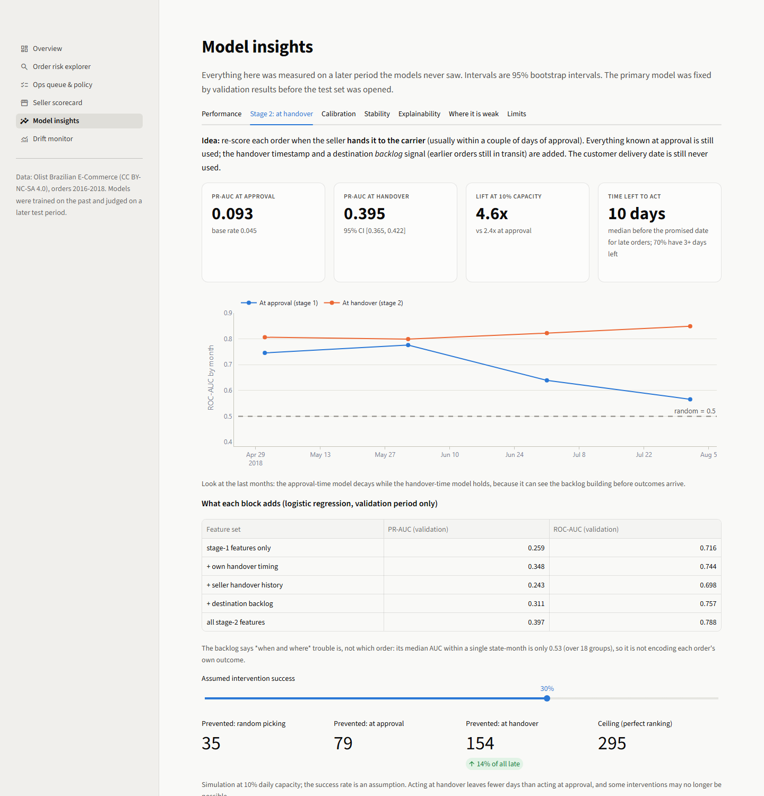
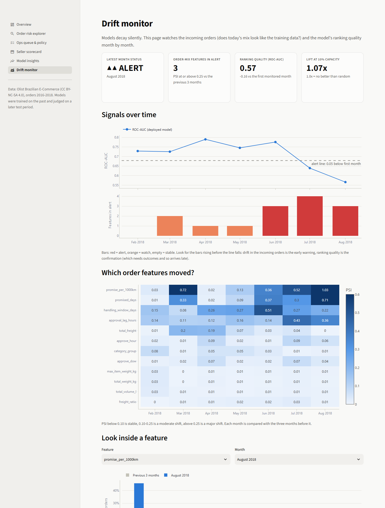

# OnTime - Explainable Late-Delivery Risk Engine

[](https://github.com/TheInfiniteLoop22/OnTime/actions/workflows/ci.yml)

**Predict, at the moment an e-commerce order is approved, whether it will miss the date promised to
the customer; explain every prediction in plain English; and turn the scores into a
capacity-aware plan for which orders operations should act on today.**

Built on the public [Olist Brazilian E-Commerce dataset](https://www.kaggle.com/datasets/olistbr/brazilian-ecommerce)
with classical ML only (logistic regression, EBM, LightGBM, random forest). No deep learning.

> This file is **generated** by `make report` from the project's result files, so every number
> below was produced by code in this repository (see `docs/templates/README.template.md`).

---

## Why it matters

Customers punish broken delivery promises. In this data, late orders are rated
**0.6 to 2.0 stars lower** than on-time orders after adjusting for price,
category, region, season and distance (an adjusted association, not a proven causal effect), and
**63%** of late orders end in a 1-2 star review versus **9%** of
on-time ones.

The twist: **70% of late orders were reviewed before the parcel arrived.**
Most of the damage happens while the customer is still waiting, so operations must act *before* the
promised date, which is exactly what a prediction at approval time enables.

## Headline results (test period, never used for tuning)

| | |
|---|---|
| Test period | 2018-05-01 to 2018-08-18 - 24,093 orders, 1,096 late (4.5%) |
| Primary model | **Logistic regression** (chosen by validation results *before* the test set was opened) |
| Ranking quality | PR-AUC **0.093** [0.085, 0.105] vs 0.045 for random ranking (2.0x better) |
| Capacity value | Acting on the riskiest 10% of each day's orders: precision **10.0%**, lift **2.2x** [1.85, 2.62] |
| Beats a hand-written rule? | Yes: the rule's PR-AUC is 0.048, essentially the base rate (0.045), while Logistic regression scores 0.093. |
| Glass-box vs black-box | EBM minus LightGBM = -0.004 PR-AUC, 95% CI [-0.009, +0.002] (no reliable difference) |
| Simulated benefit | at 10% daily capacity and an assumed 30% intervention success, about 74 late orders prevented (6.7% of all late) vs 33 for random selection; ceiling with perfect ranking 306 |
| **Stage 2: re-score at carrier handover** | PR-AUC **0.395** [0.365, 0.422] on the same orders (0.093 at approval), ROC-AUC 0.826, lift **4.6x** at 10% capacity; late orders have a median 10 days left to act |

| Model | PR-AUC [95% CI] | ROC-AUC | Brier | Lift @10% [95% CI] |
|---|---|---|---|---|
| Guess the training rate | 0.045 [0.043, 0.048] | 0.500 | 0.0435 | 1.03 [0.89, 1.17] |
| Hand-written rule | 0.048 [0.045, 0.051] | 0.527 | 0.0436 | 0.94 [0.75, 1.15] |
| **Logistic regression** | 0.093 [0.085, 0.105] | 0.701 | 0.0435 | 2.20 [1.85, 2.62] |
| Random forest | 0.075 [0.069, 0.083] | 0.665 | 0.0462 | 1.63 [1.38, 1.89] |
| LightGBM | 0.078 [0.072, 0.086] | 0.683 | 0.0428 | 1.96 [1.66, 2.28] |
| EBM (glass-box) | 0.074 [0.068, 0.082] | 0.656 | 0.0430 | 1.64 [1.36, 1.96] |

PR-AUC is judged against the base rate (random ranking scores the late rate), and intervals are 95%
bootstrap intervals. Full detail: [`reports/results.md`](reports/results.md).

## How it works



### What makes it rigorous
- **No leakage.** Features use only what is known at approval time. Seller/route history counts a
  past order only if it was *delivered before* the current order's approval time (approval time
  alone is not enough). Five required leakage tests plus a property test against a brute-force loop.
- **Time-based splits only.** Train past -> validation -> test future; tuning and calibration use
  different, time-ordered slices of validation.
- **Test set touched once.** The code, the primary-model rule and the test run were committed in
  that order; the test split is locked behind an explicit `final_evaluation=True`.
- **No invented numbers.** Results, this README and the model card are generated from run outputs.
- **Honest reporting.** The negative results are in the write-up: see *Limitations*.

## Stage 2: re-score the order when the seller hands it to the carrier

At approval, almost nothing about a fresh local problem (a carrier strike, a storm) can be seen:
outcome history only updates after parcels are *delivered*. But a few days later the seller hands the
parcel to the carrier, which is observable long before delivery. Stage 2 re-scores each order at
that moment with the approval-time features **plus**:

- the order's own handover timing (days to handover, handover versus the seller's shipping limit,
  promise days left),
- the seller's recent handover punctuality,
- a **destination backlog**: of earlier orders to the same state handed over 8-28 days ago, the share
  *still undelivered today*, which rises as a regional problem builds, days before outcomes arrive.

Same leakage discipline: the customer delivery date and reviews are never used; the backlog counts a
delivery only if it happened on a day before the decision day; events come from all orders, not only
ones that were eventually delivered. Tests include a brute-force equality check and a "future
deliveries must not change the feature" test.

| Test period | Stage 1 (at approval) | Stage 2 (at handover) |
|---|---|---|
| PR-AUC [95% CI] | 0.093 | **0.395** [0.365, 0.422] |
| ROC-AUC | 0.701 | 0.826 |
| Lift at 10% daily capacity | 2.4x | **4.6x** [4.13, 5.05] |
| Paired PR-AUC difference | | +0.302 [+0.271, +0.330] |
| Paired lift@10% difference | | +2.23 [+1.55, +2.86] |

Both columns are scored on the same orders and grouped by the *decision day* (handover day), so stage 1's lift here (2.4x) differs slightly from the headline table above, which groups by approval day. The population is the 94,913 orders with a valid handover timestamp.

| Month | Late rate | ROC-AUC at approval | ROC-AUC at handover | Lift@10% at approval | Lift@10% at handover |
|---|---|---|---|---|---|
| 2018-05 | 6.5% | 0.75 | 0.81 | 2.93 | 3.81 |
| 2018-06 | 1.2% | 0.78 | 0.80 | 3.78 | 5.26 |
| 2018-07 | 3.2% | 0.64 | 0.82 | 2.82 | 4.79 |
| 2018-08 | 7.5% | 0.57 | 0.85 | 1.29 | 4.95 |

The approval-time model decays by 2018-08 (ROC-AUC 0.57); the handover-time model
holds (0.81 to 0.85). What each block adds (validation period, logistic
regression):

| Feature set | PR-AUC (validation) | ROC-AUC (validation) |
|---|---|---|
| stage-1 features only | 0.259 | 0.716 |
| + own handover timing | 0.348 | 0.744 |
| + seller handover history | 0.243 | 0.698 |
| + destination backlog | 0.311 | 0.757 |
| all stage-2 features | 0.397 | 0.788 |

- The backlog says *when and where* trouble is, not which order: its median AUC inside a single
  state-month is only 0.53, so it is not encoding an order's own outcome.
- Handover usually happens 1.2 days after approval, and 70% of
  late orders still had 3 or more days before the promised date when it happened, so there is time to act.
- Simulated policy: at 10% daily capacity and an assumed 30% success rate: about 154 late orders prevented when acting at handover (14% of all late) vs 79 when acting at approval and 35 for random picking; ceiling 295.
- **Honest status.** The test months had already been used once to evaluate stage 1. Stage 2 was
  declared separately, selected on validation (LightGBM by validation PR-AUC), scored once, and
  is reported next to stage 1 on the same orders, but it is *not* a first-look hold-out.
- **Probabilities.** Ranking is the product. A isotonic calibrator, fitted on validation only,
  brings the test Brier score from 0.1390 (raw) to 0.0348 and ECE from
  0.290 to 0.022; stage 1 scores 0.0348 vs 0.0435 Brier and
  0.015 ECE, and always predicting the true late rate scores 0.0434. Base rates
  move between periods, so treat the percentages as relative scores.
- **Reasons.** Handover timing, seller handover history and destination backlog are explained in the same
  plain-English format as stage 1 (`reports/stage2_reason_codes.parquet`).

## Promise dates: quote shorter promises where it is safe (S1)

A LightGBM *quantile* model predicts how many calendar days an order will take to arrive, at levels from
0.5 to 0.99, using only approval-time features. The promise is the predicted quantile rounded up to whole
days; "on time" is judged exactly as the dataset does (delivery date vs promised date), which the code
checks reproduces `is_late` (it refuses to run above 1% disagreement; measured: 0.00%). Levels are chosen on validation; the test months
(24,093 orders) are a third look and are labelled as such.

| Operating point (chosen on validation) | Level | Avg promise (days) | On time | vs Olist length | vs Olist on-time |
|---|---|---|---|---|---|
| Olist as quoted | - | 22.0 | 95.5% | - | - |
| model, match olist | 0.88 | 20.6 | 96.7% | -1.4 d [-1.4, -1.3] | +1.2 pp [1.0, 1.4] |
| model, cov 0.95 | 0.93 | 26.5 | 98.7% | +4.5 d [4.4, 4.6] | +3.2 pp [3.0, 3.5] |
| model, cov 0.97 | 0.97 | 36.1 | 99.6% | +14.1 d [14.0, 14.2] | +4.1 pp [3.9, 4.4] |

- Matching Olist's validation on-time share (92.4%) selected level 0.88. On the test
  months that promise is -1.4 days [-1.4, -1.3] vs Olist **and** +1.2 pp
  [1.0, 1.4] more orders on time.
- Read off the model's frontier, Olist's own on-time share would need an average promise of about
  19.1 days instead of 22.0 (descriptive, not tuned on test).
- A constant shift of 0 days on Olist's promise reaches 95.5% on time at 22.0 days. Very high levels buy little: the extreme tail is hard to predict and the promise grows
  quickly.
- Not modelled: how customers react to shorter or longer promises. See
  [`notebooks/06_promise_dates_and_api.ipynb`](notebooks/06_promise_dates_and_api.ipynb).

## Scoring API and Docker (S3)

```bash
uv sync --extra api && make api          # http://127.0.0.1:8000/docs
make docker-build && make docker-run     # same service in a container (needs `make all` first)
```

| Endpoint | What it does |
|---|---|
| `GET /health`, `GET /model-info` | liveness; model, training window, feature lists, reported metrics |
| `POST /score` | stage 1 at approval: probability, relative risk, reasons that add and reduce risk |
| `POST /score/handover` | stage 2: adds the five handover features |
| `POST /promise` | whole-day promises at several levels, plus the validated operating points |
| `GET /demo/orders/{id}` | score a known order by id (demo only) |

Payloads are validated (missing or non-numeric features return 422 with the list). The container returned
the same probability for the same order as the local run. The image is large (about 2 GB) because the
explainability stack (SHAP, InterpretML) is needed to load the saved models.

## Things I tried that did not work

Retraining monthly and dropping the calendar features were the two obvious fixes for the decay of the
approval-time model. Both were tested in a rolling-origin backtest (2018-02 to 2018-08; a development
backtest, not a clean hold-out):

| Variant | Macro ROC-AUC | Pooled lift@10% | vs deployed static model (lift diff, 95% CI) |
|---|---|---|---|
| Deployed v1 (trained once, to Jan 2018) | 0.710 | 2.37 | (reference) |
| Logistic regression, monthly retrain, all features | 0.703 | 2.34 | -0.03 [-0.10, +0.04] |
| Logistic regression, monthly retrain, no calendar proxies | 0.690 | 2.30 | -0.07 [-0.14, +0.00] |
| LightGBM, monthly retrain, all features | 0.639 | 1.82 | -0.55 [-0.70, -0.41] |
| LightGBM, monthly retrain, no calendar proxies | 0.616 | 1.72 | -0.65 [-0.79, -0.49] |

- Retraining logistic regression every month on all outcomes known by then did **not** help
  (pooled lift 2.34 vs 2.37 for the static model; difference
  -0.03 [-0.10, +0.04]).
- Dropping the calendar proxies did not help either (lift difference -0.04 [-0.10, +0.02] for logistic
  regression, -0.10 [-0.19, +0.00] for LightGBM). My earlier suggestion to remove them is **retracted**.
- Short-window history (7 and 14 days) was also checked on validation-period data and did not carry
  more signal than the existing features in the months where the model failed.

The decay was not staleness: it was a sudden local shock that outcome-based history cannot see in time.
That is what motivated Stage 2.

## Monitoring

`make monitor` computes, per month, input drift (PSI) for order-intrinsic features against the previous
three months, ranking quality of the deployed model, and a status. System-state features
(`approve_month`, `days_to_next_holiday`, `holidays_in_promise_window`, `is_black_friday_window`, `seller_n_past`, `seller_days_since_first_order`, `global_late_rate_30d`, `customer_state_late_rate_shrunk`, `route_late_rate_shrunk`, `seller_late_rate_shrunk`, `seller_late_rate_90d_shrunk`, `seller_load_7d`) move every month by design and are tracked by level, not alerted: using PSI
on them fired every single month, which made the first version of this monitor useless.

| Month | Order-mix features in alert | ROC-AUC | Status |
|---|---|---|---|
| 2018-02 | 0 | 0.73 | stable |
| 2018-03 | 2 | 0.73 | watch |
| 2018-04 | 1 | 0.79 | watch |
| 2018-05 | 1 | 0.75 | watch |
| 2018-06 | 3 | 0.78 | alert |
| 2018-07 | 4 | 0.64 | alert |
| 2018-08 | 3 | 0.57 | alert |

The monitor first reached *alert* in 2018-06; ranking quality first fell more than 0.05 below its starting level in 2018-07 (1 month(s) later). With only 7 monitored months and a rule shaped after seeing that
raw PSI always fires, this is a worked design with an encouraging pattern, not a validated early-warning
system.

## What the model sees, and why

Every prediction comes with plain-English reasons. Example (true positive, order `d115642fba30...`,
model estimate 62%, actually late):

- On this seller-state to customer-state route, about 15% of earlier orders arrived late (adds risk)
- Delivery promise is 6.7 days, with 4.0 days for the seller to hand over (adds risk)
- Seller-to-customer distance is 595 km (adds risk)
- Order approved on a Friday in August at 8:00, 16 h after purchase (reduces risk)
- Paid by credit_card in up to 10 instalment(s) (reduces risk)

Reasons are exact decompositions of the model output (coefficients for logistic regression, shape
functions for the EBM, TreeSHAP for LightGBM), grouped so one idea is shown once, and phrased as
facts: the *(adds risk / reduces risk)* tag comes from the model, never from intuition.
Across the three explanation methods, global importance agrees most between LightGBM and the EBM (rank correlation 0.78); 26 of 32 numeric features have the same effect direction in at least two models. See [`notebooks/04_explainability.ipynb`](notebooks/04_explainability.ipynb).

## The app

```
make app        # streamlit run app/Home.py   (needs the pipeline artifacts)
```

| | |
|---|---|
|  |  |
|  |  |
|  |  |
|  |  |

## Run it yourself

```bash
git clone https://github.com/TheInfiniteLoop22/OnTime.git && cd OnTime
make setup                         # uv sync + pre-commit  (Python 3.11, uv required)

# 1) data: either use the Kaggle API (put kaggle.json in ~/.kaggle) ...
make data
# ... or download the zip manually and unzip the 9 CSVs into data/raw/

make all                           # data -> build -> features -> impact -> baselines
                                   #   -> train -> evaluate -> explain -> report
make app                           # open the Streamlit app
make test && make lint             # pytest (incl. a synthetic mini-Olist pipeline run) and ruff
```

Individual stages: `make stage2` (handover model), `make eta` (promise dates), `make monitor` (drift tables), `make rolling` (retraining study), `make scores` (precompute app scores for a fast start).

### Deploy the app

`main` deliberately contains no data or models. `make bundle` builds a ~25 MB self-contained `deploy` branch (app, source, the generated artifacts the app reads, a runtime-only `requirements.txt`) without touching `main`. On [share.streamlit.io](https://share.streamlit.io): New app -> this repository -> branch `deploy` -> main file `app/Home.py` -> Python 3.11. The bundle holds derived, anonymised order-level data from a CC BY-NC-SA dataset: keep it non-commercial and attributed.

The test suite includes an integration test that generates a tiny synthetic Olist-shaped dataset and
runs the real stages on it, so CI never needs the Kaggle download.

## Repository map

| Path | What is there |
|---|---|
| `src/ontime/data` | download, load, pandera schemas, DuckDB order table, data-quality report |
| `src/ontime/features` | geo, calendar, product and leak-safe history features, leakage demo |
| `src/ontime/models` | splits (test locked), baselines, training, tuning, calibration |
| `src/ontime/evaluation` | metrics with bootstrap CIs, slices, policy simulation, plots, results report |
| `src/ontime/explain` | EBM / SHAP / coefficient explanations, agreement, reason codes |
| `src/ontime/serving` | scoring + what-if service used by the app |
| `src/ontime/stage2` | handover-time features (backlog, handover timing) and the stage-2 model |
| `src/ontime/eta` | quantile promise-date model (S1) |
| `src/ontime/api` | FastAPI scoring service (S3), see `Dockerfile` |
| `src/ontime/monitoring` | PSI drift and performance-by-month monitor |
| `src/ontime/deploy` | deploy-branch bundle builder |
| `app/` | Streamlit app (`Home.py`, `views/`, `ontime_ui/`) |
| `notebooks/` | 01 EDA, 02 impact analysis, 03 modelling walkthrough, 04 explainability, 05 diagnosing the decay and the handover stage, 06 promise dates and the API |
| `reports/` | generated results, model card, figures (the data and models are git-ignored) |
| `docs/` | specs, `PHASE_LOG.md` (what was done), `DECISIONS_LOG.md` (why), `LEARNING_LOG.md` (interview notes) |

## Limitations

- **Probabilities are relative scores.** The late rate moved from 5.6% (training) to
  4.5% (test) and month to month; calibrated percentages are overconfident for the
  riskiest orders. Use rank and risk bands. Monthly re-calibration did not fix this.
- **The approval-time ranking decays.** Primary-model ROC-AUC was 0.75 in 2018-05 and
  0.57 in 2018-08; monthly retraining did not fix it. Stage 2 (re-scoring at handover) holds
  up, but it is a second look at the same months and needs fresh data to be confirmed.
- **Modest, not magic.** Most late orders are not predictable from approval-time information (a
  carrier incident, a stock-out). The value is a better *queue*, not certainty.
- **Simulation, not measurement.** The policy benefit assumes an intervention success rate; the
  dataset has no experiment on interventions.
- **Associations, not causes.** Explanations describe the model; the review-score gap is adjusted
  but observational.
- **Calendar proxies.** `approve_month` and the holiday features mostly encode the part of the year
  the training data covered; removing them did not improve out-of-time ranking in the retraining study.
- **One marketplace, 2016-2018.** Nothing here is validated on other platforms or periods.

## Future work

1. Confirm Stage 2 and the promise model on genuinely new data (the same months were seen two and three
   times).
2. A randomized pilot to measure the intervention success rate the policy simulator assumes, and the
   demand response to shorter promises.
3. Streamlit Community Cloud deployment from the `deploy` branch (see below), and scheduled retraining
   driven by the drift monitor.
4. Slim the API image (export the models to ONNX or drop SHAP at inference) if size matters.

## Data and licence

Olist Brazilian E-Commerce Public Dataset, CC BY-NC-SA 4.0: non-commercial use, attribution
required, share alike. The raw data is **not** committed; download it yourself. Code in this
repository is for portfolio/educational use.

## Documentation

[`docs/PROJECT_SPEC.md`](docs/PROJECT_SPEC.md) · [`docs/FEATURE_SPEC.md`](docs/FEATURE_SPEC.md) ·
[`docs/BUILD_PLAN.md`](docs/BUILD_PLAN.md) · [`docs/PHASE_LOG.md`](docs/PHASE_LOG.md) ·
[`docs/DECISIONS_LOG.md`](docs/DECISIONS_LOG.md) · [`docs/LEARNING_LOG.md`](docs/LEARNING_LOG.md) ·
[`reports/model_card.md`](reports/model_card.md) · [`reports/results.md`](reports/results.md) ·
[`reports/impact.json`](reports/impact.json)
