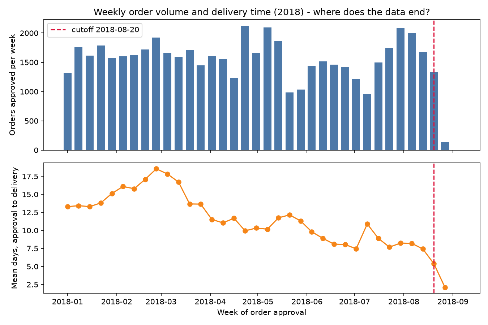

# Data quality report

<!-- raw-quality:start -->
## Raw data quality (generated by `ontime.data.quality`)

### Row counts
| table                |    rows |   columns |
|:---------------------|--------:|----------:|
| orders               |   99441 |         8 |
| order_items          |  112650 |         7 |
| products             |   32951 |         9 |
| sellers              |    3095 |         4 |
| customers            |   99441 |         5 |
| geolocation          | 1000163 |         5 |
| payments             |  103886 |         5 |
| reviews              |   99224 |         7 |
| category_translation |      71 |         2 |

### Schema validation
| table                | pandera   |
|:---------------------|:----------|
| orders               | pass      |
| order_items          | pass      |
| products             | pass      |
| sellers              | pass      |
| customers            | pass      |
| geolocation          | pass      |
| payments             | pass      |
| reviews              | pass      |
| category_translation | pass      |

### Null percentages (columns with any nulls)
| table    | column                        |   null_pct |
|:---------|:------------------------------|-----------:|
| orders   | order_approved_at             |       0.16 |
| orders   | order_delivered_carrier_date  |       1.79 |
| orders   | order_delivered_customer_date |       2.98 |
| products | product_category_name         |       1.85 |
| products | product_name_lenght           |       1.85 |
| products | product_description_lenght    |       1.85 |
| products | product_photos_qty            |       1.85 |
| products | product_weight_g              |       0.01 |
| products | product_length_cm             |       0.01 |
| products | product_height_cm             |       0.01 |
| products | product_width_cm              |       0.01 |
| reviews  | review_comment_title          |      88.34 |
| reviews  | review_comment_message        |      58.7  |

### Duplicate keys
| table                | key                         |   duplicate_rows |
|:---------------------|:----------------------------|-----------------:|
| orders               | order_id                    |                0 |
| order_items          | order_id+order_item_id      |                0 |
| products             | product_id                  |                0 |
| sellers              | seller_id                   |                0 |
| customers            | customer_id                 |                0 |
| payments             | order_id+payment_sequential |                0 |
| reviews              | review_id                   |              814 |
| category_translation | product_category_name       |                0 |

### Out-of-range / inconsistent values
| check                                                 |   count |
|:------------------------------------------------------|--------:|
| orders: approved_at before purchase_timestamp         |       0 |
| orders: delivered_customer_date before approved_at    |      61 |
| orders: delivered but missing delivered_customer_date |       8 |
| orders: non-delivered but has delivered_customer_date |       6 |
| order_items: price == 0                               |       0 |
| order_items: freight == 0                             |     383 |
| products: weight_g == 0                               |       4 |

### Geolocation
- geolocation rows: **1,000,163**
- outside Brazil bounding box: **42**
- distinct zip prefixes: **19,015**
- exact duplicate rows: **261,831**
- customer rows with prefix missing from geolocation: **278**
- seller rows with prefix missing from geolocation: **7**
<!-- raw-quality:end -->

<!-- order-funnel:start -->
## Order-table population funnel (generated by `ontime.data.build_orders`)

| step                                         |   rows_remaining |   rows_dropped |
|:---------------------------------------------|-----------------:|---------------:|
| all orders                                   |            99441 |              0 |
| status == delivered                          |            96478 |           2963 |
| approved_at not null                         |            96464 |             14 |
| delivered_customer_date not null             |            96456 |              8 |
| estimated_delivery_date not null             |            96456 |              0 |
| delivered_customer_date >= approved_at       |            96395 |             61 |
| has at least one item (primary seller known) |            96395 |              0 |
| approved_at < censoring cutoff (2018-08-20)  |            94937 |           1458 |

### Censoring cutoff: orders approved on/after **2018-08-20** are excluded
Weekly view of the final weeks (all orders with an approval time, any status):

| week       |   orders |   delivered_share |   mean_delivery_days | late_rate   |
|:-----------|---------:|------------------:|---------------------:|:------------|
| 2018-07-23 |     1746 |             0.98  |                7.681 | 0.027       |
| 2018-07-30 |     2088 |             0.974 |                8.241 | 0.082       |
| 2018-08-06 |     2006 |             0.977 |                8.201 | 0.093       |
| 2018-08-13 |     1677 |             0.987 |                7.431 | 0.04        |
| 2018-08-20 |     1336 |             0.994 |                5.383 | 0.023       |
| 2018-08-27 |      135 |             1     |                2.096 | 0.0         |
| 2018-09-03 |        1 |             0     |              nan     | <NA>        |

<!-- order-funnel:end -->
