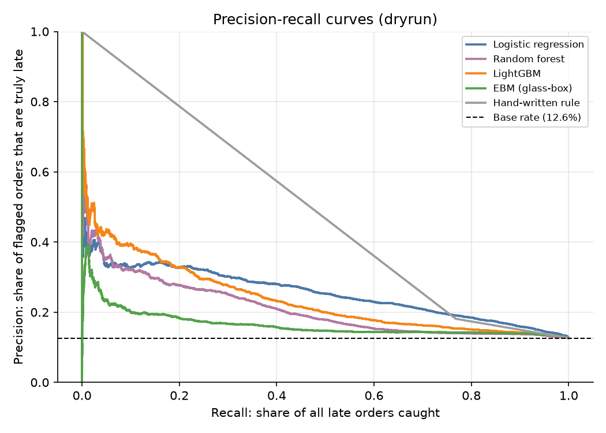
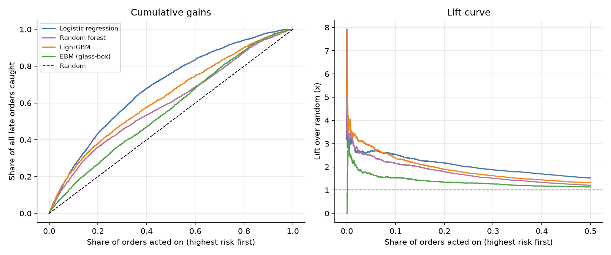
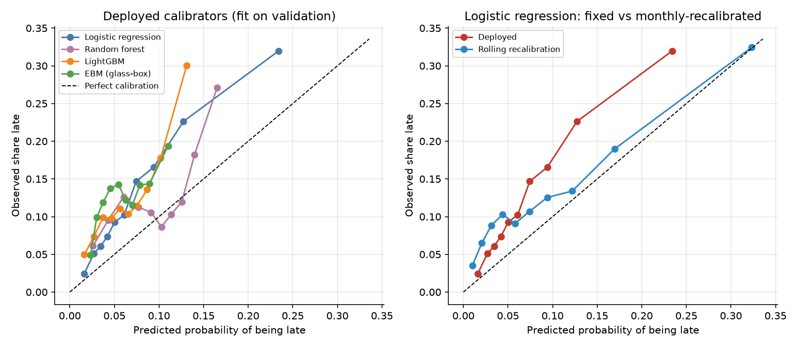
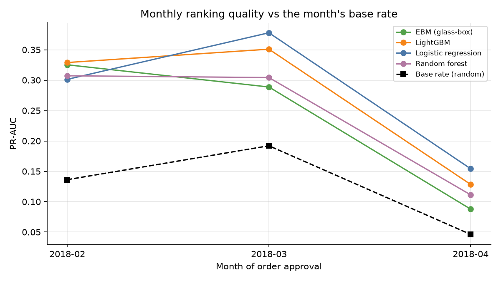
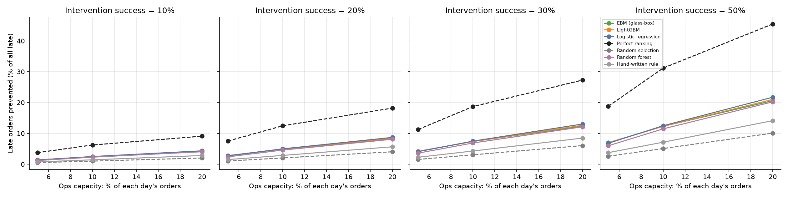

# OnTime - results on the VALIDATION set (dry run - not a result)

_Generated by `ontime.evaluation.run` from `results.json`; no number in this file is typed by hand._

## 1. Evaluation population
- Orders approved 2018-02-01 to 2018-04-30: **20,241** orders, **2,556** late (**12.6%**).
- Training-period late rate was 5.6%: expect probability levels to be off when the base rate has moved (see section 4).
- Primary model: **Logistic regression**. Pre-registered before test was opened: highest PR-AUC on val_calib (validation data never used for tuning).

## 2. Model comparison
Probabilities are the deployed (validation-calibrated) ones. CIs are 95% percentile bootstrap (orders resampled; lift@10% resamples whole days).

| model | PR-AUC [95% CI] | ROC-AUC | Brier | log loss | precision@10% | recall@10% | lift@10% [95% CI] |
|---|---|---|---|---|---|---|---|
| Base rate | 0.126 [0.122, 0.131] | 0.500 | 0.1152 | 0.414 | 12.9% | 10.4% | 1.02 [0.93, 1.13] |
| Hand-written rule | 0.168 [0.162, 0.175] | 0.633 | 0.1136 | 0.401 | 17.7% | 14.3% | 1.40 [1.27, 1.53] |
| Logistic regression | 0.255 [0.241, 0.270] | 0.713 | 0.1066 | 0.365 | 30.9% | 25.0% | 2.45 [2.30, 2.63] |
| Random forest | 0.210 [0.197, 0.223] | 0.612 | 0.1093 | 0.378 | 28.4% | 22.9% | 2.25 [2.11, 2.39] |
| LightGBM | 0.237 [0.222, 0.252] | 0.648 | 0.1109 | 0.390 | 30.4% | 24.6% | 2.41 [2.28, 2.54] |
| EBM (glass-box) | 0.164 [0.154, 0.174] | 0.577 | 0.1138 | 0.407 | 30.4% | 24.6% | 2.41 [2.27, 2.55] |

Random-ranking PR-AUC equals the base rate (0.126). Rule baseline: seller and customer in different states AND promised_days < 32.1.

### Precision / recall at ops capacity
| model | k | precision | recall | lift | precision 95% CI |
|---|---|---|---|---|---|
| Logistic regression | 5% | 32.9% | 13.6% | 2.61 | [28.3%, 37.9%] |
| Logistic regression | 10% | 30.9% | 25.0% | 2.45 | [26.6%, 35.6%] |
| Logistic regression | 20% | 27.2% | 43.5% | 2.15 | [23.6%, 30.9%] |
| Random forest | 5% | 29.0% | 12.0% | 2.30 | [24.3%, 34.0%] |
| Random forest | 10% | 28.4% | 22.9% | 2.25 | [23.8%, 33.0%] |
| Random forest | 20% | 25.3% | 40.5% | 2.00 | [21.2%, 29.6%] |
| LightGBM | 5% | 33.7% | 13.9% | 2.67 | [28.1%, 39.0%] |
| LightGBM | 10% | 30.4% | 24.6% | 2.41 | [25.6%, 35.2%] |
| LightGBM | 20% | 26.3% | 42.1% | 2.08 | [22.2%, 30.7%] |
| EBM (glass-box) | 5% | 34.0% | 14.0% | 2.69 | [28.1%, 39.9%] |
| EBM (glass-box) | 10% | 30.4% | 24.6% | 2.41 | [25.2%, 35.8%] |
| EBM (glass-box) | 20% | 25.8% | 41.2% | 2.04 | [21.6%, 30.2%] |

## 3. Glass-box vs black-box (paired bootstrap on PR-AUC)
- **EBM minus LightGBM**: -0.073 PR-AUC, 95% CI [-0.084, -0.063] - the interval excludes zero (a real difference).
- **Logistic regression minus LightGBM**: +0.018 PR-AUC, 95% CI [0.009, 0.027] - the interval excludes zero (a real difference).
- **EBM minus logistic regression**: -0.091 PR-AUC, 95% CI [-0.101, -0.081] - the interval excludes zero (a real difference).
- **Logistic regression minus hand-written rule**: +0.087 PR-AUC, 95% CI [0.075, 0.100] - the interval excludes zero (a real difference).

## 4. Calibration
Deployed = calibrator fitted once on validation. Rolling = sigmoid refitted each month on orders delivered in the previous 60 days (only outcomes known before the month began).

| model | calibrator | Brier deployed | Brier rolling | ECE deployed | ECE rolling |
|---|---|---|---|---|---|
| Logistic regression | none | 0.1066 | 0.1054 | 0.0502 | 0.0316 |
| Random forest | none | 0.1093 | 0.1102 | 0.0385 | 0.0611 |
| LightGBM | sigmoid | 0.1109 | 0.1051 | 0.0619 | 0.0484 |
| EBM (glass-box) | sigmoid | 0.1138 | 0.1112 | 0.0662 | 0.0647 |

Reference: a constant prediction at the true test rate has Brier 0.1103; the training-rate prior scores 0.1152.

## 5. Month-by-month stability
| month | model | orders | late rate | PR-AUC | ROC-AUC | lift@10% | mean predicted (deployed) |
|---|---|---|---|---|---|---|---|
| 2018-02 | Logistic regression | 6,534 | 13.6% | 0.301 | 0.729 | 2.34 | 6.1% |
| 2018-03 | Logistic regression | 7,083 | 19.2% | 0.378 | 0.725 | 2.23 | 7.9% |
| 2018-04 | Logistic regression | 6,624 | 4.6% | 0.154 | 0.790 | 3.75 | 8.8% |
| 2018-02 | LightGBM | 6,534 | 13.6% | 0.329 | 0.737 | 2.46 | 4.9% |
| 2018-03 | LightGBM | 7,083 | 19.2% | 0.351 | 0.664 | 2.33 | 6.5% |
| 2018-04 | LightGBM | 6,624 | 4.6% | 0.128 | 0.677 | 2.66 | 7.9% |
| 2018-02 | EBM (glass-box) | 6,534 | 13.6% | 0.325 | 0.734 | 2.51 | 4.0% |
| 2018-03 | EBM (glass-box) | 7,083 | 19.2% | 0.289 | 0.604 | 2.40 | 6.1% |
| 2018-04 | EBM (glass-box) | 6,624 | 4.6% | 0.088 | 0.645 | 2.18 | 7.9% |

## 6. Where the primary model is weak (slices)
Full table for every model: `slices.csv`. Flagged = ROC-AUC more than 0.05 below the model's overall ROC-AUC, among slices with enough late orders to measure.

| slice | value | orders | late rate | ROC-AUC | overall ROC-AUC |
|---|---|---|---|---|---|
| customer_region | CO | 1,226 | 13.7% | 0.604 | 0.713 |
| customer_region | N | 340 | 24.7% | 0.628 | 0.713 |
| customer_region | NE | 1,830 | 24.6% | 0.605 | 0.713 |
| customer_region | S | 2,940 | 11.5% | 0.654 | 0.713 |
| distance_bucket | 100-300 | 2,822 | 9.0% | 0.638 | 0.713 |
| distance_bucket | <100 | 3,713 | 3.7% | 0.584 | 0.713 |
| distance_bucket | >1500 | 1,803 | 23.2% | 0.608 | 0.713 |
| category_group | appliances | 479 | 6.3% | 0.647 | 0.713 |
| route_type | same state | 7,308 | 5.6% | 0.598 | 0.713 |

## 7. Policy simulation: what is acting on the top-k% worth?
**This is a simulation with stated assumptions.** An intervention prevents a would-be-late order from being late with probability p (not observable in this data; swept below). Capacity k applies per day. 'Random' is the analytic expectation of picking orders blindly; 'Perfect ranking' is the capacity-limited upper bound.

| capacity k | success p | strategy | late orders prevented (expected) | % of all late | gain over random [95% CI] |
|---|---|---|---|---|---|
| 5% | 10% | Logistic regression | 35 | 1.4% | +21 [+18, +25] |
| 5% | 10% | Perfect ranking | 96 | 3.8% | +83 [+83, +83] |
| 5% | 10% | Random selection | 13 | 0.5% | +0 [+0, +0] |
| 5% | 10% | Hand-written rule | 19 | 0.8% | +6 [+3, +9] |
| 5% | 20% | Logistic regression | 69 | 2.7% | +43 [+36, +50] |
| 5% | 20% | Perfect ranking | 192 | 7.5% | +165 [+165, +165] |
| 5% | 20% | Random selection | 27 | 1.0% | +0 [+0, +0] |
| 5% | 20% | Hand-written rule | 38 | 1.5% | +12 [+7, +17] |
| 5% | 30% | Logistic regression | 104 | 4.1% | +64 [+54, +74] |
| 5% | 30% | Perfect ranking | 288 | 11.3% | +248 [+248, +248] |
| 5% | 30% | Random selection | 40 | 1.6% | +0 [+0, +0] |
| 5% | 30% | Hand-written rule | 58 | 2.3% | +18 [+10, +26] |
| 5% | 50% | Logistic regression | 174 | 6.8% | +107 [+90, +124] |
| 5% | 50% | Perfect ranking | 480 | 18.8% | +414 [+414, +414] |
| 5% | 50% | Random selection | 66 | 2.6% | +0 [+0, +0] |
| 5% | 50% | Hand-written rule | 96 | 3.8% | +30 [+17, +43] |
| 10% | 10% | Logistic regression | 64 | 2.5% | +38 [+32, +44] |
| 10% | 10% | Perfect ranking | 159 | 6.2% | +133 [+133, +133] |
| 10% | 10% | Random selection | 26 | 1.0% | +0 [+0, +0] |
| 10% | 10% | Hand-written rule | 36 | 1.4% | +11 [+7, +14] |
| 10% | 20% | Logistic regression | 128 | 5.0% | +76 [+65, +87] |
| 10% | 20% | Perfect ranking | 319 | 12.5% | +267 [+267, +267] |
| 10% | 20% | Random selection | 52 | 2.0% | +0 [+0, +0] |
| 10% | 20% | Hand-written rule | 73 | 2.9% | +21 [+14, +28] |
| 10% | 30% | Logistic regression | 191 | 7.5% | +113 [+97, +131] |
| 10% | 30% | Perfect ranking | 478 | 18.7% | +400 [+400, +400] |
| 10% | 30% | Random selection | 78 | 3.1% | +0 [+0, +0] |
| 10% | 30% | Hand-written rule | 110 | 4.3% | +32 [+21, +42] |
| 10% | 50% | Logistic regression | 319 | 12.5% | +189 [+162, +218] |
| 10% | 50% | Perfect ranking | 796 | 31.2% | +667 [+667, +667] |
| 10% | 50% | Random selection | 130 | 5.1% | +0 [+0, +0] |
| 10% | 50% | Hand-written rule | 182 | 7.1% | +53 [+35, +71] |
| 20% | 10% | Logistic regression | 111 | 4.3% | +60 [+52, +68] |
| 20% | 10% | Perfect ranking | 232 | 9.1% | +181 [+181, +181] |
| 20% | 10% | Random selection | 52 | 2.0% | +0 [+0, +0] |
| 20% | 10% | Hand-written rule | 72 | 2.8% | +21 [+15, +26] |
| 20% | 20% | Logistic regression | 222 | 8.7% | +119 [+103, +137] |
| 20% | 20% | Perfect ranking | 465 | 18.2% | +362 [+362, +362] |
| 20% | 20% | Random selection | 103 | 4.0% | +0 [+0, +0] |
| 20% | 20% | Hand-written rule | 144 | 5.6% | +41 [+31, +52] |
| 20% | 30% | Logistic regression | 333 | 13.0% | +179 [+155, +205] |
| 20% | 30% | Perfect ranking | 698 | 27.3% | +543 [+543, +543] |
| 20% | 30% | Random selection | 155 | 6.1% | +0 [+0, +0] |
| 20% | 30% | Hand-written rule | 217 | 8.5% | +62 [+46, +77] |
| 20% | 50% | Logistic regression | 556 | 21.7% | +298 [+259, +341] |
| 20% | 50% | Perfect ranking | 1162 | 45.5% | +905 [+905, +905] |
| 20% | 50% | Random selection | 258 | 10.1% | +0 [+0, +0] |
| 20% | 50% | Hand-written rule | 361 | 14.1% | +103 [+77, +129] |

Illustrative translation to customer experience: each prevented late order is worth about 0.55 review stars (conservative, reviews after delivery) to 1.97 (full adjusted gap). Illustrative: stars recovered = prevented late orders x gap. Association, not causal.

## 8. Error analysis
Top-20 false positives and top-20 false negatives per model: `error_analysis_logreg.csv`, `error_analysis_random_forest.csv`, `error_analysis_lightgbm.csv`, `error_analysis_ebm.csv`.

## 9. Caveats
- Distribution shift: the late rate differs between training, validation and this period; deployed probabilities are only as good as the period they were fitted on (section 4).
- The policy section is a simulation; the success probability p is an assumption.
- Review-star translation is an association (Phase 3), not a causal effect.
- Models were fitted on the training period only; none was refit on validation data.
