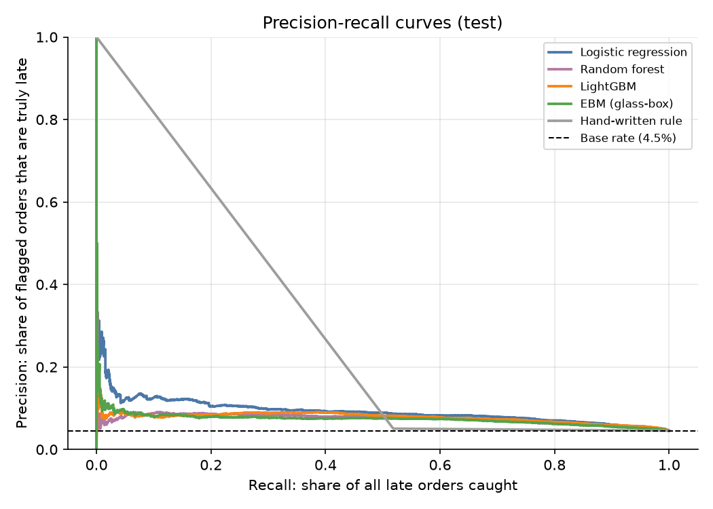
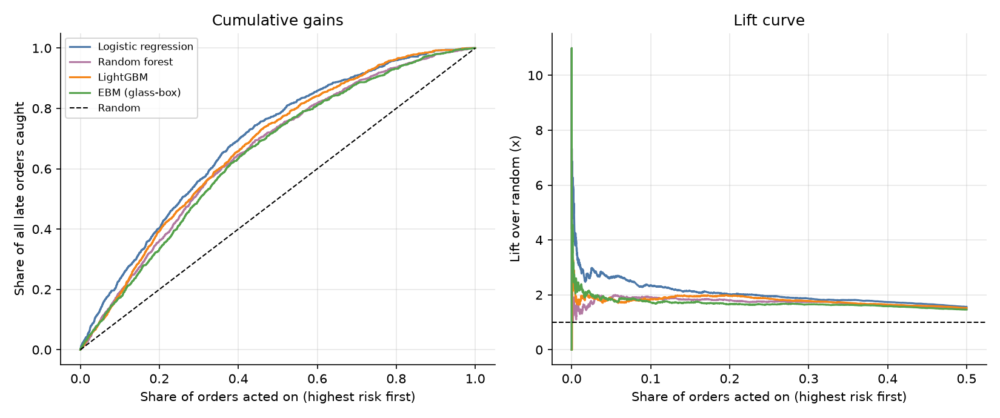
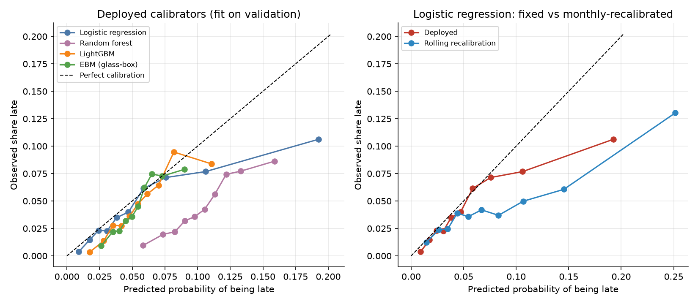
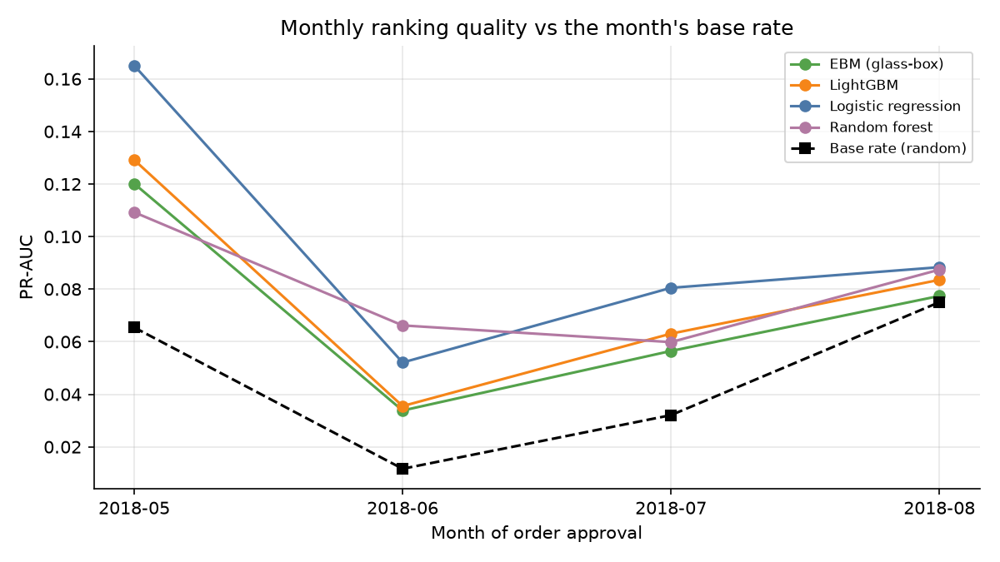
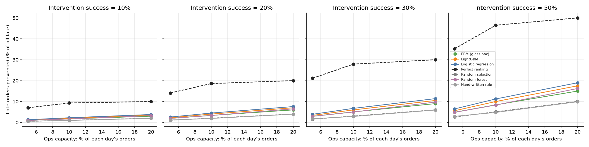

# OnTime - results on the TEST set (opened once)

_Generated by `ontime.evaluation.run` from `results.json`; no number in this file is typed by hand._

## 1. Evaluation population
- Orders approved 2018-05-01 to 2018-08-18: **24,093** orders, **1,096** late (**4.5%**).
- Training-period late rate was 5.6%: expect probability levels to be off when the base rate has moved (see section 4).
- Primary model: **Logistic regression**. Pre-registered before test was opened: highest PR-AUC on val_calib (validation data never used for tuning).

## 2. Model comparison
Probabilities are the deployed (validation-calibrated) ones. CIs are 95% percentile bootstrap (orders resampled; lift@10% resamples whole days).

| model | PR-AUC [95% CI] | ROC-AUC | Brier | log loss | precision@10% | recall@10% | lift@10% [95% CI] |
|---|---|---|---|---|---|---|---|
| Guess the training rate | 0.045 [0.043, 0.048] | 0.500 | 0.0435 | 0.186 | 4.7% | 10.5% | 1.03 [0.89, 1.17] |
| Hand-written rule | 0.048 [0.045, 0.051] | 0.527 | 0.0436 | 0.186 | 4.3% | 9.6% | 0.94 [0.75, 1.15] |
| Logistic regression | 0.093 [0.085, 0.105] | 0.701 | 0.0435 | 0.177 | 10.0% | 22.4% | 2.20 [1.85, 2.62] |
| Random forest | 0.075 [0.069, 0.083] | 0.665 | 0.0462 | 0.202 | 7.4% | 16.6% | 1.63 [1.38, 1.89] |
| LightGBM | 0.078 [0.072, 0.086] | 0.683 | 0.0428 | 0.178 | 8.9% | 20.0% | 1.96 [1.66, 2.28] |
| EBM (glass-box) | 0.074 [0.068, 0.082] | 0.656 | 0.0430 | 0.180 | 7.5% | 16.8% | 1.64 [1.36, 1.96] |

Random-ranking PR-AUC equals the base rate (0.045). Rule baseline: seller and customer in different states AND promised_days < 32.1.

### Precision / recall at ops capacity
| model | k | precision | recall | lift | precision 95% CI |
|---|---|---|---|---|---|
| Logistic regression | 5% | 11.3% | 13.0% | 2.48 | [9.2%, 13.4%] |
| Logistic regression | 10% | 10.0% | 22.4% | 2.20 | [8.3%, 11.9%] |
| Logistic regression | 20% | 8.6% | 38.0% | 1.88 | [7.1%, 10.2%] |
| Random forest | 5% | 8.4% | 9.7% | 1.85 | [6.8%, 10.2%] |
| Random forest | 10% | 7.4% | 16.6% | 1.63 | [6.1%, 8.7%] |
| Random forest | 20% | 7.3% | 32.5% | 1.61 | [6.2%, 8.5%] |
| LightGBM | 5% | 9.8% | 11.2% | 2.15 | [7.9%, 11.7%] |
| LightGBM | 10% | 8.9% | 20.0% | 1.96 | [7.3%, 10.7%] |
| LightGBM | 20% | 7.9% | 35.0% | 1.74 | [6.6%, 9.2%] |
| EBM (glass-box) | 5% | 8.5% | 9.8% | 1.87 | [6.5%, 10.6%] |
| EBM (glass-box) | 10% | 7.5% | 16.8% | 1.64 | [5.8%, 9.5%] |
| EBM (glass-box) | 20% | 6.8% | 30.0% | 1.49 | [5.4%, 8.2%] |

## 3. Glass-box vs black-box (paired bootstrap on PR-AUC)
- **EBM minus LightGBM**: -0.004 PR-AUC, 95% CI [-0.009, 0.002] - the interval includes zero (no reliable difference).
- **Logistic regression minus LightGBM**: +0.015 PR-AUC, 95% CI [0.009, 0.024] - the interval excludes zero (a real difference).
- **EBM minus logistic regression**: -0.019 PR-AUC, 95% CI [-0.028, -0.012] - the interval excludes zero (a real difference).
- **Logistic regression minus hand-written rule**: +0.045 PR-AUC, 95% CI [0.039, 0.055] - the interval excludes zero (a real difference).

## 4. Calibration
Deployed = calibrator fitted once on validation. Rolling = sigmoid refitted each month on orders delivered in the previous 60 days (only outcomes known before the month began).

| model | calibrator | Brier deployed | Brier rolling | ECE deployed | ECE rolling |
|---|---|---|---|---|---|
| Logistic regression | none | 0.0435 | 0.0454 | 0.0150 | 0.0373 |
| Random forest | none | 0.0462 | 0.0488 | 0.0580 | 0.0639 |
| LightGBM | sigmoid | 0.0428 | 0.0455 | 0.0120 | 0.0433 |
| EBM (glass-box) | sigmoid | 0.0430 | 0.0484 | 0.0108 | 0.0616 |

Reference: a constant prediction at the true evaluation-set rate has Brier 0.0434; the training-rate prior scores 0.0435.

## 5. Month-by-month stability
| month | model | orders | late rate | PR-AUC | ROC-AUC | lift@10% | mean predicted (deployed) |
|---|---|---|---|---|---|---|---|
| 2018-05 | Logistic regression | 6,940 | 6.5% | 0.165 | 0.746 | 2.83 | 5.3% |
| 2018-06 | Logistic regression | 6,094 | 1.2% | 0.052 | 0.776 | 3.16 | 4.3% |
| 2018-07 | Logistic regression | 6,021 | 3.2% | 0.081 | 0.639 | 2.58 | 6.7% |
| 2018-08 | Logistic regression | 5,038 | 7.5% | 0.088 | 0.566 | 1.07 | 8.1% |
| 2018-05 | Random forest | 6,940 | 6.5% | 0.109 | 0.644 | 1.62 | 9.7% |
| 2018-06 | Random forest | 6,094 | 1.2% | 0.066 | 0.722 | 3.43 | 8.8% |
| 2018-07 | Random forest | 6,021 | 3.2% | 0.060 | 0.643 | 2.03 | 11.1% |
| 2018-08 | Random forest | 5,038 | 7.5% | 0.087 | 0.586 | 1.10 | 12.2% |
| 2018-05 | LightGBM | 6,940 | 6.5% | 0.129 | 0.689 | 2.16 | 4.9% |
| 2018-06 | LightGBM | 6,094 | 1.2% | 0.036 | 0.728 | 3.30 | 4.1% |
| 2018-07 | LightGBM | 6,021 | 3.2% | 0.063 | 0.662 | 2.33 | 5.9% |
| 2018-08 | LightGBM | 5,038 | 7.5% | 0.084 | 0.560 | 1.28 | 7.5% |
| 2018-05 | EBM (glass-box) | 6,940 | 6.5% | 0.120 | 0.672 | 2.20 | 5.1% |
| 2018-06 | EBM (glass-box) | 6,094 | 1.2% | 0.034 | 0.682 | 2.47 | 4.4% |
| 2018-07 | EBM (glass-box) | 6,021 | 3.2% | 0.056 | 0.590 | 1.62 | 5.7% |
| 2018-08 | EBM (glass-box) | 5,038 | 7.5% | 0.077 | 0.522 | 0.83 | 6.7% |

## 6. Where the primary model is weak (slices)
Full table for every model: `slices.csv`. Flagged = ROC-AUC more than 0.05 below the model's overall ROC-AUC, among slices with enough late orders to measure.

| slice | value | orders | late rate | ROC-AUC | overall ROC-AUC |
|---|---|---|---|---|---|
| customer_region | NE | 2,176 | 7.4% | 0.595 | 0.701 |
| customer_region | S | 3,215 | 2.8% | 0.626 | 0.701 |
| approval_month | 2018-07 | 6,021 | 3.2% | 0.639 | 0.701 |
| approval_month | 2018-08 | 5,038 | 7.5% | 0.566 | 0.701 |

## 7. Policy simulation: what is acting on the top-k% worth?
**This is a simulation with stated assumptions.** An intervention prevents a would-be-late order from being late with probability p (not observable in this data; swept below). Capacity k applies per day. 'Random' is the analytic expectation of picking orders blindly; 'Perfect ranking' is the capacity-limited upper bound.

| capacity k | success p | strategy | late orders prevented (expected) | % of all late | gain over random [95% CI] |
|---|---|---|---|---|---|
| 5% | 10% | Logistic regression | 14 | 1.3% | +8 [+6, +11] |
| 5% | 10% | Perfect ranking | 77 | 7.0% | +71 [+71, +71] |
| 5% | 10% | Random selection | 6 | 0.5% | +0 [+0, +0] |
| 5% | 10% | Hand-written rule | 6 | 0.6% | +1 [-1, +2] |
| 5% | 20% | Logistic regression | 28 | 2.6% | +17 [+12, +22] |
| 5% | 20% | Perfect ranking | 154 | 14.1% | +143 [+143, +143] |
| 5% | 20% | Random selection | 11 | 1.0% | +0 [+0, +0] |
| 5% | 20% | Hand-written rule | 13 | 1.2% | +1 [-2, +5] |
| 5% | 30% | Logistic regression | 43 | 3.9% | +25 [+18, +34] |
| 5% | 30% | Perfect ranking | 232 | 21.1% | +214 [+214, +214] |
| 5% | 30% | Random selection | 17 | 1.6% | +0 [+0, +0] |
| 5% | 30% | Hand-written rule | 19 | 1.8% | +2 [-3, +7] |
| 5% | 50% | Logistic regression | 71 | 6.5% | +42 [+30, +56] |
| 5% | 50% | Perfect ranking | 386 | 35.2% | +357 [+357, +357] |
| 5% | 50% | Random selection | 29 | 2.6% | +0 [+0, +0] |
| 5% | 50% | Hand-written rule | 32 | 2.9% | +3 [-4, +12] |
| 10% | 10% | Logistic regression | 25 | 2.2% | +13 [+10, +17] |
| 10% | 10% | Perfect ranking | 102 | 9.3% | +91 [+91, +91] |
| 10% | 10% | Random selection | 11 | 1.0% | +0 [+0, +0] |
| 10% | 10% | Hand-written rule | 10 | 1.0% | -1 [-3, +2] |
| 10% | 20% | Logistic regression | 49 | 4.5% | +27 [+20, +35] |
| 10% | 20% | Perfect ranking | 204 | 18.6% | +181 [+181, +181] |
| 10% | 20% | Random selection | 22 | 2.0% | +0 [+0, +0] |
| 10% | 20% | Hand-written rule | 21 | 1.9% | -1 [-6, +3] |
| 10% | 30% | Logistic regression | 74 | 6.7% | +40 [+30, +52] |
| 10% | 30% | Perfect ranking | 306 | 27.9% | +272 [+272, +272] |
| 10% | 30% | Random selection | 33 | 3.1% | +0 [+0, +0] |
| 10% | 30% | Hand-written rule | 32 | 2.9% | -2 [-8, +5] |
| 10% | 50% | Logistic regression | 123 | 11.2% | +67 [+50, +87] |
| 10% | 50% | Perfect ranking | 510 | 46.5% | +454 [+454, +454] |
| 10% | 50% | Random selection | 56 | 5.1% | +0 [+0, +0] |
| 10% | 50% | Hand-written rule | 52 | 4.8% | -3 [-14, +8] |
| 20% | 10% | Logistic regression | 42 | 3.8% | +20 [+14, +26] |
| 20% | 10% | Perfect ranking | 110 | 10.0% | +88 [+88, +88] |
| 20% | 10% | Random selection | 22 | 2.0% | +0 [+0, +0] |
| 20% | 10% | Hand-written rule | 22 | 2.0% | -0 [-4, +3] |
| 20% | 20% | Logistic regression | 83 | 7.6% | +39 [+27, +52] |
| 20% | 20% | Perfect ranking | 219 | 20.0% | +175 [+175, +175] |
| 20% | 20% | Random selection | 44 | 4.0% | +0 [+0, +0] |
| 20% | 20% | Hand-written rule | 43 | 4.0% | -1 [-8, +5] |
| 20% | 30% | Logistic regression | 125 | 11.4% | +59 [+41, +78] |
| 20% | 30% | Perfect ranking | 329 | 30.0% | +263 [+263, +263] |
| 20% | 30% | Random selection | 66 | 6.0% | +0 [+0, +0] |
| 20% | 30% | Hand-written rule | 65 | 5.9% | -1 [-12, +8] |
| 20% | 50% | Logistic regression | 208 | 19.0% | +98 [+68, +130] |
| 20% | 50% | Perfect ranking | 548 | 50.0% | +438 [+438, +438] |
| 20% | 50% | Random selection | 110 | 10.1% | +0 [+0, +0] |
| 20% | 50% | Hand-written rule | 108 | 9.9% | -2 [-20, +13] |

Illustrative translation to customer experience: each prevented late order is worth about 0.55 review stars (conservative, reviews after delivery) to 1.97 (full adjusted gap). Illustrative: stars recovered = prevented late orders x gap. Association, not causal.

## 8. Error analysis
Top-20 false positives and top-20 false negatives per model: `error_analysis_logreg.csv`, `error_analysis_random_forest.csv`, `error_analysis_lightgbm.csv`, `error_analysis_ebm.csv`.

## 9. Caveats
- Distribution shift: the late rate differs between training, validation and this period; deployed probabilities are only as good as the period they were fitted on (section 4).
- The policy section is a simulation; the success probability p is an assumption.
- Review-star translation is an association (Phase 3), not a causal effect.
- Models were fitted on the training period only; none was refit on validation data.
